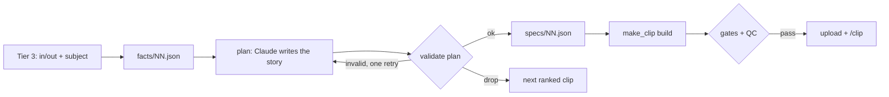

# Spec: story-first shorts

**Status:** draft for Jatin's review, 2026-11-21. Nothing here is built yet.

**The ask (George, via Jatin):** "proper story-wise shorts — it should actually
feel like someone reviewed each short and everything had something thought
behind it."

**The reference:** Chris (@everestchris6), "here's the full setup to automate
high quality gta 6 content", 2026-11-19
(https://x.com/everestchris6/status/2123463535632232528). Six slides and one
29.3s example Short (IShowSpeed, "SPEED STOLE GRANDMA'S SCOOTER"). This is the
same GTA workflow the handoff calls "George's GTA-style workflow slides".

It is **one creator's workflow and one example clip.** Treat it the way
AGENTS.md treats R1 and R2: observations, not laws.

---

## 1. What the reference does

The slides describe six steps:

| step | their tool | what it does |
|---|---|---|
| find | Apify | finds stream clips already blowing up |
| read | ElevenLabs + code | every word with who said it; facecam / game / clutter boxes; every crash and every quiet stretch |
| plan | Claude | writes the whole edit as a plan **before anything renders** |
| build | code | cuts, captions, mix; code checks every build |
| review | Claude critics + judge | three critics who never saw the plan, then a judge: pass, or "not yet" back to the plan |
| post | — | only what passes |

The three "tell claude" boxes are the parts that matter for us:

1. **Read the clip before you cut anything.** The facecam, the game, the
   clutter, every word and who said it. *Plan from these facts.*
2. **Write the edit as a plan before anything renders.** Find the story,
   **give every beat one feeling and one treatment**, open on the payoff.
3. **When I complain, turn it into a rule.** If code can check it, add a
   check. If not, add it to the notes. The same complaint never comes back.

And one rule that came out of their complaints: **"story first: no graphic
just because we have it."**

### Measured on their example (480p download, 29.3s)

| | |
|---|---|
| Duration | 29.3s |
| Layout | facecam top, game bottom, caption on the seam (our L2) |
| Cold open | **~1.0s of the ending** (the arrest, Speed shouting) under the title, then a hard cut back to the start of the theft |
| Title | 2 lines: small white top line, big yellow keyword ("SCOOTER"); holds ~1.5s |
| Picture cuts (lower pane) | 8 in 29.3s (4.5, 8.5, 11.0, 13.7, 14.6, 17.2, 20.0, 26.7s): **~16/min, ~3.3s mean shot** |
| Beats | theft → guilt → cops → busted → tail: four story beats in under 30s |
| Payoff treatment | desaturated freeze + "BUSTED" banner, then his real reaction |
| Loudness | −13.9 LUFS integrated, LRA 3.6 LU (music under voice) |

That cut rate is gameplay storytelling, not a talking head (R1 cut 6/min, R2
never). It tells us what a story beat looks like on gameplay, not how often
our talk clips should cut.

### What we take, and what we don't

Settled decisions in the handoff still hold. This spec takes the clip-quality
ideas only.

| from the post | here |
|---|---|
| Apify to find clips | **no.** We find clips in George's own VODs (regions, chat spikes, kill feed). |
| ElevenLabs transcription + speakers | **no.** faster-whisper already gives word timings; speaker labels are a keyless step (§3.1). |
| Music, sad music, chase music, sirens | **no music** (settled). Feeling is carried by picture, captions and treatments. |
| Auto-posting | **no.** Clips land on the web app for George as now. |
| Read the clip first | **yes**, as a facts sheet per clip (§3.1). |
| Story plan, one feeling + one treatment per beat | **yes**, the core of this spec (§3.2). |
| Open on the payoff | **yes, as an option the plan chooses**, with a gate (§3.3). |
| Code checks every build | **yes.** We already have gates + QC; add the missing ones (§3.4). |
| Blind critics + judge | **changed**, and only if Jatin asks. See §3.5 and why #19 failed. |
| Complaints become rules | **yes**, formalised (§3.6). |

---

## 2. Why our clips don't read as reviewed today

Following one clip through `pipeline/core.py`:

1. **Tier 3** (`engine/tier3.py`) picks an in-point and out-point and writes
   `setup / claim / consequence / subject`. That is a *selection*, not a story.
2. **`titles`** (`engine/titler.py`) writes a title from the words.
3. **`popups`** adds a card for every player or team named (up to 3), whether
   or not the clip needs it.
4. **`specs`** stamps the same house `STYLE` on every clip
   (`hook: None, cards: [], booms: [], stories: "off"`...), varied only by
   genre (frag clips lose chat and zoom; kill clips lose captions).
5. **`make_clip`** renders it.

Nothing between steps 1 and 5 decides **what this clip is about, where it
turns, what each part should feel like, or why a treatment is there.** Every
clip of the same genre gets the same edit. That sameness is what reads as
automated, and it is what the post's plan step exists to remove.

The popups are the clearest case of the post's "graphics are just filler"
complaint: they fire because a name was said, not because a beat needs the
viewer to know who that is.

---

## 3. The design

Two new artifacts per clip, both JSON in the job dir beside the existing
files, both reviewable before a frame renders (the reason `edit.json`
exists):

- `facts/NN.json`: what is in the clip. Measured, no model.
- `plans/NN.json`: the story and the edit. Written by Claude **from the
  facts**, validated by code.

`specs` then turns the plan into the make_clip spec instead of stamping
`STYLE` on it.



### 3.1 Read: the facts sheet (`engine/facts.py`, no model)

Everything the plan may refer to, in clip seconds. Most of it already exists
in the job dir; this step gathers it into one place.

| fact | source | exists? |
|---|---|---|
| words with start/end | `words/NN.json` | yes |
| speaker per utterance: `streamer` / `other` / `unknown` | below | partly (#14) |
| sentence ends (for snapping beats) | punctuation, utterance ends, ≥0.5s word gaps (as #19's snapper did) | partly |
| mutes / absent audio | `muted_regions.json`, `qc.dead_audio(min_run=0.3)` | yes |
| quiet stretches (real silence, not mutes) | word gaps ≥1.0s outside mutes | trivial |
| loud events (the post's "crashes"): onsets well over the local speech level | `detect_audio` | partly |
| chat spikes and their peak second | `chat_spikes` | yes |
| kills and last-kill time | `kills.json` | yes (kill clips) |
| on-screen document changes | `cuts.content_scenes()` | yes |
| facecam box, content box | facecam detector (`cam.json`) | yes |
| genre, setup / claim / consequence, subject | Tier 3 | yes |

**Speaker labels.** The post uses ElevenLabs plus "the mouth on the facecam
says who said it". We already have half of a keyless version:
`resolve_captions.background` (#14) marks runs of 6+ words sitting ≥7 dB
under the streamer's level as someone else. #14 also measured where it fails:
casters as loud as FNS stay in. The second signal is the post's: mouth-region
motion inside the facecam box for each utterance. Level says "quiet ⇒ not
him", mouth motion says "mouth still ⇒ not him", and where the two disagree
or the face is lost the label is `unknown`. **Never guess** (AGENTS.md
"Never guess a speaker"). A keyless voice-embedding model on Modal is the
fallback if that proves too noisy; it is the speaker-coloured captions work
already offered in the handoff, and it would let other voices get blue
captions instead of being dropped.

Phase 1 uses the level signal only; mouth motion is phase 2.

### 3.2 Plan: the story first (`engine/plan.py`, one Claude call per clip)

Input: the facts sheet as text, the AGENTS.md editorial rules (one narrative,
finish the sentence, include the prompt, explain itself), the treatment
vocabulary below, and the rules file from §3.6.

Output (strict JSON, validated). Example, written for the "open qualifiers"
rant described in AGENTS.md; the times are illustrative:

```json
{
  "logline": "FNS says open qualifiers will be a disaster: ping, cheaters, no Riot support",
  "title": "OPEN QUALIFIERS WILL BE A DISASTER",
  "title_keyword": "DISASTER",
  "cold_open": null,
  "beats": [
    {"start": 0.0,  "end": 6.4,  "role": "setup",      "feeling": "curiosity",
     "treatment": "banner", "banner": "OPEN QUALIFIERS",
     "why": "names the subject before he does"},
    {"start": 6.4,  "end": 22.0, "role": "escalation", "feeling": "frustration",
     "treatment": "none", "why": "his delivery carries it"},
    {"start": 22.0, "end": 33.0, "role": "payoff",     "feeling": "outrage",
     "treatment": "emphasis", "why": "the line people will quote"},
    {"start": 33.0, "end": 36.1, "role": "button",     "feeling": "deadpan",
     "treatment": "big_cam", "why": "his face sells the last line"}
  ],
  "drop": null
}
```

Rules the prompt states and the validator enforces:

- **`logline` is one line with no "and then".** The one-narrative test from
  AGENTS.md, now written down per clip where George can read it.
- **2–5 beats**, contiguous, covering the clip. Every `start`/`end` snaps
  to a sentence end in the facts sheet, or the plan is rejected (never invent
  a timestamp).
- **Roles:** `setup`, `turn`, `escalation`, `payoff`, `button`.
  Exactly one `payoff`.
- **One feeling per beat**, from a closed list (curiosity, tension,
  frustration, outrage, disbelief, regret, relief, triumph, deadpan, hype).
  A closed list stops the model writing "a mix of emotions".
- **One treatment per beat, and `none` is a first-class answer.** Every
  other treatment needs a `why` tied to the beat. Story first: no graphic
  just because we have it.
- **`drop`**: the planner may refuse the clip ("no turn, no payoff",
  "doesn't explain itself") with a reason. A dropped clip frees its slot for
  the next ranked one, which beats shipping it.
- A plan that fails validation is sent back once with the errors; a second
  failure falls back to today's behaviour (the clip ships with house STYLE,
  marked "unplanned" on the card). A planner error never costs a clip.

**Treatment vocabulary.** Only things make_clip can render, minus what the
settled decisions and docs/SKILLS.md rule out:

| treatment | renders via | allowed on |
|---|---|---|
| `none` | — | all |
| `banner` | `titles.banner` (skill 7) | take, receipts |
| `emphasis` | caption emphasis on the beat's key words | clips with captions |
| `card` | popup / story card for a name **said in this beat** | take, receipts |
| `big_cam` | facecam grows for the beat | reaction beats; on kill clips only after the last kill (settled) |
| `slowmo` | one per clip, payoff only (gates already enforce one) | frag |
| `freeze_banner` | **new**: hold a frame, desaturate, one-word banner (the post's "BUSTED") | frag payoff only |
| `grade` | **new**: per-beat grade shift (e.g. cold on a regret beat), via `native_grade` | any, max one per clip |

The title is not a beat treatment: every clip keeps one, now written from the
logline and payoff instead of from the words alone.

Not in the vocabulary: music; zoom-ins or punch-ins on talk clips (skill 9:
in no reference); zoom-ins on gameplay (settled); speed ramps on talk clips;
booms anywhere but a `payoff` beat (and booms stay an explicit list, so `[]`
keeps meaning "none").

**Popups move under the plan.** `core.popups` still finds names and
pictures, but a card renders only when a beat asks for it.

### 3.3 Cold open (phase 2, new in make_clip)

The example opens on ~1.0s of the ending under the title, then cuts back to
the start. For us: play the plan's `cold_open` span (one complete sentence or
one reaction, ≤2.5s) under the title, then the clip from its in-point as now.

This touches a **[checked]** rule (non-contiguous speech), so it needs its own
gate:

- the cold-open span is **contiguous** and **one complete sentence**, or has
  no speech (a reaction);
- it lies inside the clip and is **played again in full** later, so nothing
  is stitched out of context;
- it does not replace the setup: the in-point stays at the first word of the
  setup (AGENTS.md: "take: the first word of the SETUP, never the claim").

Optional per plan (`cold_open: null` is valid). Off for receipts clips, whose
point is the build-up.

### 3.4 Build: code checks before anyone looks

"Anything it can measure is fixed before a critic ever looks." We already run
`engine.gates.check` on the plan and `engine.qc.check` on the file. Add what
the post lists that we lack, plus the checks the plan creates:

| check | where | status |
|---|---|---|
| caption lands on the word | `snap_words`, caption onsets (#13) | exists |
| no one-frame flash: per-**pane** luminance at **full frame rate** | `qc` | found by hand in AGENTS.md (the `endFrame` bug); make it a QC check |
| no frozen game pane on frag clips (≥3s with ~0 frame delta) | `qc` | new; document panes are exempt, they hold still on purpose |
| every treatment starts and ends with its beat (±0.1s): the post's "a mood ends with its beat" | `gates` | new |
| plan timestamps all snap to facts | plan validator | new |
| cold-open contiguity (§3.3) | `gates` | new, phase 2 |
| no graphic outside a beat that asked for it | `gates` | new |

### 3.5 Review: what changes from #19 (phase 3, only if Jatin asks)

#19 added three critics and a judge after QC. Jatin tried it and reverted it
(#20): **the judge's edits weren't better.** Reading #19, the reason is
structural rather than the prompt:

- The clips had **no plan**, so the judge could only use what it had: trim
  the front, trim the end, replace the title. None of those make a clip feel
  more thought-through; they make it shorter or rename it.
- The judge **edited the clip directly**, so its taste replaced Tier 3's with
  nothing to check it against.

So this spec builds the plan first and gets Jatin's verdict on that
**before** review is reconsidered. If review comes back, it changes in three
ways:

1. **Critics still never see the plan**; they judge what's on screen. The
   **judge** sees the plan and the critiques and answers one question: does
   the render deliver the logline and the payoff?
2. **The judge doesn't edit.** "Not yet" sends the faults to the **planner**,
   which rewrites the plan, and code rebuilds from it. Fixes always go through
   the validated plan.
3. **One round**, then ship the better of the two with the review shown on
   the card. A review error never costs a clip (kept from #19).

### 3.6 Complaints become rules (`config/editor_rules.md`)

AGENTS.md already does this by hand, but it is 7,900 lines written for us,
not for the planner. Add a short, flat file the planner reads on every call.
Entries look like this (examples from existing decisions):

```
- (George, 2026-11-19) No zoom-ins on gameplay. CHECKED: specs sets reframe=False on frag
- (Jatin, 2026-11-19) Reaction clips keep subtitles; only his own kill clips lose them. CHECKED: specs
- (Jatin, 2026-11-20) Review must not edit the clip directly. NOTE
```

Each entry: who said it, when, the rule, and either `CHECKED: <where>` (code
enforces it, with a test) or `NOTE` (the planner is told). When Jatin or
George complains about a clip, the fix lands here in the same PR, so the same
complaint can't come back.

Phase 4: a "note on this clip" box on each clip card in the web app, stored
in D1, so complaints arrive attached to the clip they're about.

### 3.7 Show the thinking on the web app

The plan makes clips *feel* reviewed only if the editing shows, and it helps
that George can *see* it. Each clip card gets the logline and one line per
beat (`setup · curiosity · banner — names the subject`). Cheap to render, and
it answers "did anyone think about this" directly.

---

## 4. Phases

Each phase is one PR, tried on scratch copies of existing jobs with a
`_probe` Modal app (`~/.capy/work/review_probe.py`), never on George's live
jobs. Jatin judges each from frames before it merges.

| phase | ships | done when |
|---|---|---|
| **1. Facts + plan, existing treatments only** | `engine/facts.py`, `engine/plan.py` + validator, `specs` driven by the plan (banner, emphasis, card, big_cam, slowmo), popups gated by beats, `config/editor_rules.md`, logline + beats on the clip card, tests | 10 clips from v7qpamcw4r (FNS) and ydb4v7ey5a (yayster) rebuilt both ways; Jatin compares frame sheets **blind to which is which** and prefers the planned version on most |
| **2. New treatments** | cold open + its gate, `freeze_banner`, per-beat `grade`, §3.4 QC checks, mouth-motion speaker labels | same comparison on 2 more VODs; each new check has a test that fails on the bug it targets |
| **3. Review (only if Jatin asks)** | critics + plan-aware judge, faults back to the planner | blind comparison against phase-2 output |
| **4. Complaint box** | per-clip note in the web app → D1 → `editor_rules.md` triage | — |

Phase 1 alone covers most of the ask: the plan, the logline and "no graphic
without a reason" are what make a clip feel thought about.

## 5. Cost

Estimates to confirm on the phase-1 probe, not measurements:

- Facts: CPU only, seconds per clip. Mouth motion (phase 2) reuses the
  facecam detector's frames.
- Plan: one Sonnet call per clip with a few thousand tokens of facts. Small
  next to Tier 3's up-to-40 region calls, so a small slice of the ~$1/job
  Claude spend.
- Review (phase 3): #19 sent 24 frames to each of 3 critics plus a judge per
  clip, and needed a longer `build_clip` timeout for the rebuild. The
  expensive part, and the reason it's last.

## 6. Open questions for Jatin

1. **Phase 1's success test:** blind side-by-side frame sheets of 10 clips,
   you pick. Right bar?
2. **Cold open on talk clips?** The example is gameplay. On a take it means
   playing the punchline for ~2s before the setup. Default here: the
   planner's call, gated (§3.3). You may want frag clips only.
3. **Review loop:** leave it out (default, given #20), or bring the
   plan-aware version back in phase 3?
4. **Dropped clips:** OK for the planner to drop a weak clip and promote the
   next ranked one, even if a job then ships fewer than asked when the VOD
   runs out?
